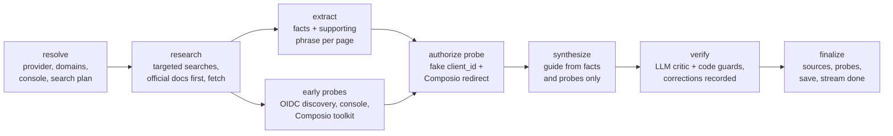

# OAuth App Readiness

**Will your OAuth app take an hour or six weeks?** Look up any app your AI agent's users need to connect, and get a
shareable guide to getting your own OAuth app created and approved. It covers difficulty, hands-on effort versus the
wait for approval, what blocks people, what an agent can do for you, and how sure we are about each claim.

- **Library:** 8 researched and spot-checked guides that span the difficulty range, plus the 100-app target catalog.
- **Live investigation:** type any app name or website. A LangGraph agent researches it, probes the provider's real
  OAuth endpoints, writes the guide, has a separate verifier check every claim, and streams its progress to the page.
- **Shareable output:** every guide has a permalink, a Markdown export (for a ticket or doc) and JSON.

## The problem, as I understood it

A developer building on Composio needs three things, which are easy to confuse:

1. **The provider OAuth app.** Its client ID, secret, redirect URI and scopes are registered once. Its name is what end
   users see on the consent screen, and it is the thing that may need approval.
2. **The auth config.** Composio-managed apps exist for some toolkits. Otherwise you bring your own app and
   register `https://backend.composio.dev/api/v3/toolkits/auth/callback`.
3. **Each end user's connection.** Approval problems surface here: "unverified app" screens, 100-user caps, a
   tenant admin who must consent, or an org owner who must approve.

The developer's real questions are about **the path, not the form**. Is there a review? How long is the wait? What
will reviewers ask for? What will a customer's admin block? Most docs answer "how to fill in the form" and bury the
rest. So the product leads with the verdict and the timeline, and treats the steps as the second layer.

## Key decisions

| Decision | Why |
|---|---|
| **Four difficulty tiers** (self-serve → light review → formal review → partner-gated) | A developer's first decision is whether to commit to this provider this sprint. The tier is judged for the scopes an AI agent realistically needs, not the easiest path, so Gmail is "formal review" even though test credentials take five minutes. |
| **Effort and wait are separate numbers on one log-scale bar** | "30 minutes of work, then up to 9 weeks of waiting" is the single most useful fact, and it is invisible when merged into one estimate. The log scale lets minutes and months share a ruler. |
| **Every step, requirement and blocker carries an evidence level** (tested, sourced, inferred, uncertain) **and citations** | Provider rules change and review times are mostly anecdotal. A guide that is confidently wrong is worse than none. The levels are enforced in code, not left to the model (see below). |
| **Every step says who does it** (agent, you, you with agent prep) | The brief asks where an agent stops. Console logins, accepting terms, DNS verification, paying for an assessment and recording a demo video are human steps. Everything around them (field values, scope lists, justification text, test flows) is prepared for you. |
| **Live probes, not just reading** | The agent calls the provider's real authorize endpoint with a fake `client_id` and Composio's redirect URI, fetches OIDC discovery metadata, checks whether the console sits behind a login wall, and checks Composio's toolkit page. These are read-only and need no credentials, and they are the only things allowed to be labelled "tested". |
| **A separate verifier pass plus deterministic guards** | The writer and the checker are different calls. After the checker, code drops citations to pages that were never fetched, downgrades "tested" without a probe, downgrades "sourced" without a citation, and marks community-only claims "uncertain". |
| **Guides are JSON files in git; live results cache for 7 days** | Curated guides are reviewable and diff-able. Generated guides are reused rather than regenerated on every visit, and "Re-investigate now" forces a refresh. |
| **Scope: guidance, not automation of the console** | Creating apps inside providers' consoles would need the developer's logins and would cross into actions the developer should take themselves. The value is knowing the path before starting. |

## What the guides found (and what changed because of checking)

| App | Tier | Hands-on | Wait | The thing most people get wrong |
|---|---|---|---|---|
| GitHub | Self-serve | 15–30 min | none | Each org's owner may still have to approve the app. New OAuth apps now get expiring tokens by default (Aug 2026). |
| Linear | Self-serve | 15–30 min | none | All apps moved to 24 h access tokens with rotating refresh tokens (Apr 2026). |
| LinkedIn | Self-serve* | 20–45 min | none | *Only sign-in and posting as the member. Anything else is partner-gated with no SLA, and there are no refresh tokens. |
| Notion | Self-serve | 30–90 min | none | Marketplace listing is optional. Tokens now refresh, and rate limits are per plan. |
| Outlook | Light review | 30 min–5 h | up to ~10 days | No Microsoft review, but customer tenants block *user* consent for Mail.Read (and calendar/contacts) by default, so plan for admin consent. |
| Slack | Light review | 30–90 min | up to ~12 wk | Public distribution is instant, but non-Marketplace apps get 1 req/min on history APIs. |
| Gmail | Formal review | 3–40 h | up to ~9 wk | `gmail.send` is *sensitive* (days). Reading mail is *restricted*: verification plus an annual CASA assessment. |
| HubSpot | Formal review | 1–11 h | up to ~11 wk | Capped at 25 installs until listed. Since mid-2026, new apps are CLI-only. |

[`docs/VERIFICATION.md`](docs/VERIFICATION.md) records what was spot-checked against primary sources, what was
corrected, and what remains unverified.

## How the agent works



- Code: `oauthguides/agent/graph.py` (graph and guards), `prompts.py`, `tools/probes.py`, `tools/search.py`, `tools/fetch.py`.
- The UI streams LangGraph's custom events over Server-Sent Events (`app/jobs.py`). A late or reconnecting browser
  replays the whole log.
- Identifying the app and extracting facts use `FAST_MODEL`. Writing and verifying use `MODEL`. The default is Gemini on its free tier, and any LangChain provider works.

## Setup (free: $0)

Everything runs on free tiers: Gemini for the model, Tavily for search and Render for hosting. No card is needed.

| Key | Where to get it | Needed? |
|---|---|---|
| `GEMINI_API_KEY` | [Google AI Studio → Get API key](https://aistudio.google.com/apikey) | For live investigation |
| `TAVILY_API_KEY` | [app.tavily.com](https://app.tavily.com) (free tier) | Strongly recommended |
| `COMPOSIO_API_KEY` | Composio dashboard | Optional |

**Keys never go in the repo.** Locally they go in `.env`, which is git-ignored. On Render they go in the dashboard's
Environment settings.

```bash
git clone https://github.com/tiku9903/composio-oauth-guides && cd composio-oauth-guides
python -m venv .venv && source .venv/bin/activate        # Windows: .venv\Scripts\activate
pip install -r requirements.txt
cp .env.example .env            # paste your keys after the = signs
uvicorn app.main:app --reload   # http://localhost:8000
```

The library works with no keys at all. To use Claude or OpenAI instead of Gemini, set `MODEL`, `FAST_MODEL` and that
provider's key (see `.env.example`).

```bash
python -m oauthguides "Zendesk"                     # investigate one app in the terminal
python scripts/build_library.py --limit 10          # grow the library from data/catalog.json
python scripts/reprobe.py                           # re-run live probes for the curated guides
pytest                                              # tests, no network or keys needed
```

### Deploy for a shareable link (Render, free plan)

1. Sign in at [render.com](https://render.com) with GitHub.
2. **New → Blueprint** → pick this repo. It reads `render.yaml`.
3. Paste `GEMINI_API_KEY` and `TAVILY_API_KEY` when asked, leave `COMPOSIO_API_KEY` blank if you don't have one, and click **Apply**.
4. After the build (a few minutes) you get `https://<name>.onrender.com`. Check `/healthz` shows `"llm_configured": true`.

The free plan sleeps after a period without visits, and the first request then takes up to a minute while it wakes.
Live-generated guides are lost when it restarts; curated guides ship with the repo. Any Docker host also works:
`docker build -t oauth-guides . && docker run -p 8000:8000 --env-file .env oauth-guides`.

**Free-tier notes:** Gemini's free tier has per-minute request limits. The agent runs at most two page extractions
at a time and retries on rate-limit errors, so an investigation may take a little longer. Google may use free-tier
prompts to improve its products; the agent only sends public documentation text and the app name.

## Limitations

- **The curated guides' live probes are mostly inconclusive.** They were written in a sandbox whose network blocked
  the providers, and each guide says so on the page. Run `python scripts/reprobe.py` from a normal network to replace
  them with real observations. The deployed agent probes live on every run.
- **Probes prove less than approval.** Without the developer's credentials an agent can show that endpoints exist,
  how they treat unknown clients, and that the console needs a login. It cannot show what a reviewer will accept.
- **Review timelines are mostly anecdotal** outside a few published targets (Google's sensitive-scope review, Slack
  and HubSpot listing review). Those claims are labelled "uncertain" and listed as questions to ask the provider.
- **Composio-managed status** is read from Composio's API only when `COMPOSIO_API_KEY` is set. Otherwise it is
  inferred from public docs and often shows as "Not confirmed".
- **Agent-generated guides are not reviewed by a person.** They are labelled as such. The path to "spot-checked" is the
  manual check described in `docs/VERIFICATION.md`.
- **Storage is local JSON.** That is fine for one instance. On ephemeral hosts, generated guides are lost on redeploy
  (curated ones ship with the repo). A production version would use a database and a shared job queue.
- **The live agent was tested end to end with a stubbed model and stubbed network** (`tests/test_agent.py`), and the
  streaming UI was tested in a headless browser. Real-model output quality varies by provider, so check a fresh guide
  before relying on it.

No credentials are stored in this repository; `.env` is git-ignored.
